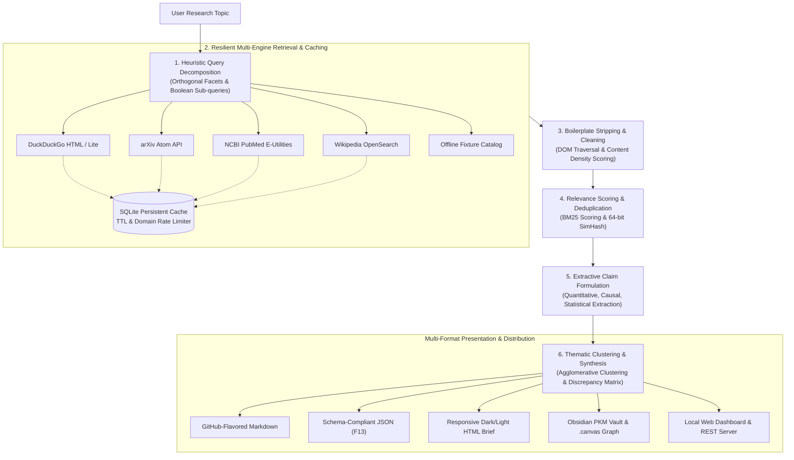

# System Architecture & Technical Specification

The **Autonomous Web Research and Knowledge Synthesis System** is an end-to-end, multi-stage knowledge extraction and automated report authoring engine implemented in **pure Python Standard Library (3.10+)** with **strictly zero external runtime dependencies**.

---

## 1. High-Level Architecture

The system operates as an extractive, citation-backed intelligence pipeline that transforms unstructured web documents and scientific literature into synthesized, schema-conforming research briefs.

---

## 2. Pipeline Execution Stages

### Stage 1: Heuristic Query Decomposition
- **Module**: [`src/research_synthesis/retrieval/decomposer.py`](file:///C:/Users/ecclj/teamwork_projects/web_research_synthesis/src/research_synthesis/retrieval/decomposer.py)
- **Objective**: Break down broad user topics into orthogonal, targeted investigation facets without semantic drift.
- **Mechanism**:
  - Extracts key domain noun phrases, acronyms, and operational entities.
  - Generates specialized boolean sub-queries across 4 distinct facets:
    1. `technical`: Core mechanisms, engineering specifications, chemistry, or algorithms.
    2. `economic`: Commercial viability, capital expenditures, supply chain economics, cost per unit.
    3. `regulatory`: Standards, environmental guidelines, policies, compliance directives.
    4. `historical`: Chronological milestones, baseline comparisons, generational shifts.
  - Assigns unique `subquery_id` values (e.g., `sq-01`, `sq-02`) preserved throughout the entire pipeline lifecycle for complete lineage auditability.

### Stage 2: Resilient Multi-Engine Retrieval & Persistent Caching
- **Module**: [`src/research_synthesis/retrieval/retriever.py`](file:///C:/Users/ecclj/teamwork_projects/web_research_synthesis/src/research_synthesis/retrieval/retriever.py), [`cache.py`](file:///C:/Users/ecclj/teamwork_projects/web_research_synthesis/src/research_synthesis/retrieval/cache.py)
- **Objective**: Retrieve candidate primary sources and scientific papers with resilient failover.
- **Connectors**:
  - **Live Search**: DuckDuckGo HTML & DuckDuckGo Lite endpoints.
  - **Academic Literature**:
    - **arXiv API**: Queries `export.arxiv.org/api/query`, parsing Atom 1.0 XML entries (`title`, `authors`, `published`, `summary`).
    - **NCBI PubMed**: Queries E-Utilities (`esearch.fcgi` for PMIDs, `esummary.fcgi` for publication metadata).
    - **Wikipedia**: OpenSearch REST API.
  - **Offline Fallback**: `MockWebRetrievalClient` backed by deterministic fixture catalogs.
- **Reliability Engineering**:
  - **Domain Rate Limiting**: Enforces polite delays between consecutive requests to the same host.
  - **Exponential Backoff**: Jittered exponential retries on `5xx` and network drops (`attempt * backoff_factor * 2^i`).
  - **Payload Caps**: 2MB download limit prevents runaway memory allocation on large binary payloads.
  - **Persistent SQLite Cache**: Zero-dependency SQLite store (`documents` & `search_queries` tables) with configurable TTL (default: 24h) and automatic expired entry pruning.

### Stage 3: DOM Boilerplate Stripping & Clean Document Parsing
- **Module**: [`src/research_synthesis/retrieval/parser.py`](file:///C:/Users/ecclj/teamwork_projects/web_research_synthesis/src/research_synthesis/retrieval/parser.py)
- **Objective**: Strip advertising, navigation chrome, tracking scripts, and cookie banners to isolate substantive article text.
- **Mechanism**:
  - Pure Python `html.parser.HTMLParser` streaming tokenizer.
  - Removes non-content tags: `<script>`, `<style>`, `<nav>`, `<header>`, `<footer>`, `<aside>`, `<noscript>`, `<svg>`.
  - **Text-to-Tag Density Scoring**: Identifies the primary content block by evaluating the ratio of textual character volume to structural HTML tags within parent nodes.
  - Extracts standardized metadata: Title (`<title>`, OpenGraph `og:title`), Author (`meta[name="author"]`, bylines), and Publication Date (`article:published_time`, ISO regex).

### Stage 4: BM25 Relevance Scoring & SimHash Deduplication
- **Module**: [`src/research_synthesis/extraction/bm25.py`](file:///C:/Users/ecclj/teamwork_projects/web_research_synthesis/src/research_synthesis/extraction/bm25.py), [`dedup.py`](file:///C:/Users/ecclj/teamwork_projects/web_research_synthesis/src/research_synthesis/extraction/dedup.py)
- **BM25 Passage Scoring**:
  - Chunks cleaned articles into sliding passage windows (3-5 sentences with sentence-boundary preservation).
  - Scores each passage against query terms using the Okapi BM25 formula:
    $$\text{Score}(D, Q) = \sum_{i=1}^{N} \text{IDF}(q_i) \cdot \frac{f(q_i, D) \cdot (k_1 + 1)}{f(q_i, D) + k_1 \cdot \left(1 - b + b \cdot \frac{|D|}{\text{avgdl}}\right)}$$
    where $k_1 = 1.5$ and $b = 0.75$.
- **64-Bit SimHash Near-Duplicate Deduplication**:
  - Computes a 64-bit SimHash fingerprint for each passage using MD5 word token hashing.
  - Bit vector accumulation: weights assigned by token term frequency.
  - Bitwise XOR and Hamming distance:
    $$\text{HammingDistance}(h_1, h_2) = \text{popcount}(h_1 \oplus h_2)$$
  - Passages with $\text{HammingDistance} \le 3$ are flagged as near-duplicates and merged into corroborating evidence groups.

### Stage 5: Extractive Claim Formulation & Inline Attribution
- **Module**: [`src/research_synthesis/extraction/claims.py`](file:///C:/Users/ecclj/teamwork_projects/web_research_synthesis/src/research_synthesis/extraction/claims.py)
- **Objective**: Extract verifiable atomic assertions with strict provenance.
- **Claim Taxonomy**:
  - `QUANTITATIVE`: Metric measurements, percentages, monetary valuations, energy densities (`Wh/kg`, `$75/kWh`, `12 mS/cm`).
  - `CAUSAL`: Cause-and-effect relationships (`leads to`, `induces`, `results in`, `triggers`).
  - `STATISTICAL`: Survey distributions, sample sizes, probability intervals (`over 62% of manufacturers surveyed`).
  - `DEFINITIONAL`: Technical terminology and foundational definitions.
- **Attribution Invariant**: Every claim retains its original document URL, exact source span offsets, and 1-based citation index `[N]`.

### Stage 6: Thematic Clustering, Discrepancy Matrix & Synthesis
- **Module**: [`src/research_synthesis/synthesis/cluster.py`](file:///C:/Users/ecclj/teamwork_projects/web_research_synthesis/src/research_synthesis/synthesis/cluster.py), [`synthesizer.py`](file:///C:/Users/ecclj/teamwork_projects/web_research_synthesis/src/research_synthesis/synthesis/synthesizer.py)
- **Hierarchical Thematic Clustering**:
  - Builds TF-IDF sparse vector representations for extracted claims.
  - Groups claims into 2 to 4 thematic clusters using centroid cosine similarity.
  - Generates descriptive section titles by combining dominant centroid terms with query facet tags.
- **Discrepancy & Conflict Detection Matrix**:
  - Identifies conflicting statements across independent sources regarding identical entities or metrics.
  - Types:
    - `NUMERICAL_VARIATION`: Numerical metrics disagreeing by $> 15\%$ (e.g., "$100/kWh by 2028" vs "$140/kWh by 2032").
    - `POLAR_CONFLICT`: Contradictory directional assertions (e.g., "accelerating" vs "plateauing").
  - Formats discrepancies into clear comparative tables in narrative sections.

---

## 3. Core Invariants & Engineering Contracts

1. **Zero External Runtime Dependencies**:
   - The production code executes solely using modules from Python's standard library (`urllib`, `json`, `sqlite3`, `re`, `http.server`, `socketserver`, `xml.etree.ElementTree`, `dataclasses`, `hashlib`, `zipfile`).
2. **Deterministic Offline Reproducibility**:
   - Running in `--mode=mock` utilizes deterministic fixtures and pseudo-random seed stability, guaranteeing that test assertions and verification suites execute identically across platforms.
3. **100% Referential Citation Integrity**:
   - Every citation marker `[N]` in the executive summary, key takeaways, and section narratives maps to a valid source in the bibliography table with identical indexing.
4. **Schema Strictness**:
   - Serialized JSON output validates strictly against [`research_brief.schema.json`](file:///C:/Users/ecclj/teamwork_projects/web_research_synthesis/research_brief.schema.json).
5. **Cross-Platform Console Encoding Safety**:
   - Standard output and error streams explicitly configure UTF-8 encoding with fallback replacement handling, preventing CP1252 character map crashes on Windows consoles.
